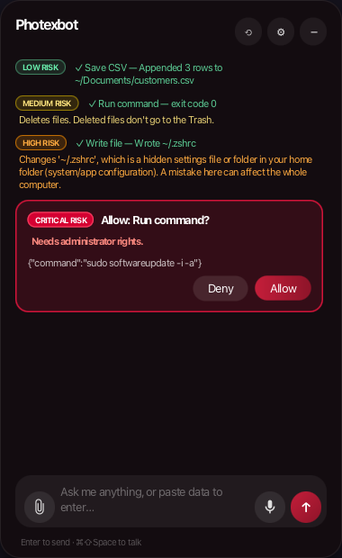

  

<h1 align="center">Photexbot</h1>

  A Siri-style desktop assistant for macOS, Windows and Ubuntu, built for data entry. 
  It floats as a small glowing orb, listens to your voice or your typing, and does the work on your computer.

## Download

Pick your computer and click to download. Java is bundled, so nothing else is needed.

| Computer | Download | Size |
|---|---|---|
| **Mac with Apple Silicon** (M1 and later) | [Photexbot-1.0.3-macos-arm64.dmg](https://github.com/photexnp/Photexbot-releases/releases/download/v1.0.3/Photexbot-1.0.3-macos-arm64.dmg) | 118 MB |
| **Mac with Intel** | [Photexbot-1.0.3-macos-x64.dmg](https://github.com/photexnp/Photexbot-releases/releases/download/v1.0.3/Photexbot-1.0.3-macos-x64.dmg) | 120 MB |
| **Windows 10/11** (installer) | [Photexbot-1.0.3-windows-x64.msi](https://github.com/photexnp/Photexbot-releases/releases/download/v1.0.3/Photexbot-1.0.3-windows-x64.msi) | 120 MB |
| **Windows** (portable, no install) | [Photexbot-1.0.3-windows-x64-portable.zip](https://github.com/photexnp/Photexbot-releases/releases/download/v1.0.3/Photexbot-1.0.3-windows-x64-portable.zip) | 118 MB |
| **Ubuntu 22.04+ / Debian** | [photexbot_1.0.3_amd64.deb](https://github.com/photexnp/Photexbot-releases/releases/download/v1.0.3/photexbot_1.0.3_amd64.deb) | 115 MB |

Not sure which Mac you have? Apple menu → **About This Mac**: "Chip: Apple M…" means Apple Silicon, "Processor: Intel" means Intel.
All versions are on the [Releases page](https://github.com/photexnp/Photexbot-releases/releases).

---

## What it does

- **Fills forms and spreadsheets for you.** Paste or attach your data, click into the first field, and Photexbot types every
  value, tabbing between fields and rows. It works with web forms, CRMs, Excel, Google Sheets and desktop apps.
- **Reads any file you attach.** PDFs (including scans, with a vision model), Word, Excel, PowerPoint, CSV, images and text.
  Drag files onto the window or use the paperclip.
- **Creates files.** Word documents, Excel workbooks with formulas, PowerPoint decks, PDFs, charts, ZIP archives, and any
  text format (CSV, HTML, JSON, calendar invites, contacts, code…). New files land in `~/Documents/Photexbot` with an Open button.
- **Does everyday computer tasks.** Opens apps, files and websites, finds and organises files, and runs shell commands.
- **Voice, like Siri** (macOS). Tap the mic or press **⌘⇧Space** anywhere, speak, and it answers aloud. Recognition runs on
  the device.
- **Your choice of AI.** Ollama (local or cloud models), OpenAI, Anthropic Claude, Google Gemini, or any OpenAI-compatible
  service. API keys are kept in the macOS Keychain (or a private file on Windows and Linux), never in the project.

## Risk indicators

Photexbot doesn't block what you ask for. Instead, every action is labelled with a risk level and a plain-language reason,
so you can decide.

  

| Badge | Examples |
|---|---|
| 🟢 **Low** | Reading files, typing data, opening apps, documents and websites, saving new files |
| 🟡 **Medium** | Replacing or deleting your own files, opening System Settings |
| 🟠 **High** | Changing system folders or hidden config (`~/.zshrc`, `~/Library`, AppData), installing or removing software, services and startup items, opening installers or scripts, log-out shortcuts, typing a command into another app |
| 🔴 **Critical** | Admin rights (`sudo`), erasing or partitioning disks, piping downloads into a shell, deleting a whole folder tree |

By default, High and Critical actions wait for you to click **Allow**. Change this in **Settings → Ask before**: Medium and above,
High and critical, Critical only, or Never (just show the risk).

## Install

| System | File | How to install |
|---|---|---|
| macOS, Apple Silicon | `Photexbot-<version>-macos-arm64.dmg` | Open it and drag **Photexbot** into **Applications** |
| macOS, Intel | `Photexbot-<version>-macos-x64.dmg` | Same as above |
| Windows 10/11 | `Photexbot-<version>-windows-x64.msi` | Double-click and follow the steps (no admin rights needed) |
| Windows, no install | `Photexbot-<version>-windows-x64-portable.zip` | Unzip anywhere and run `Photexbot\Photexbot.exe` |
| Ubuntu 22.04+ / Debian | `photexbot_<version>_amd64.deb` | `sudo apt install ./photexbot_<version>_amd64.deb` |

Java is bundled, so there's nothing else to install. The apps aren't code-signed yet, so the first launch shows a warning.
On macOS, right-click the app and choose **Open**. On Windows, click **More info → Run anyway**.

See [INSTALL.md](INSTALL.md) for permissions (Accessibility, Microphone), platform notes and uninstalling.

## Getting started

1. Launch Photexbot and click the orb to open the chat.
2. Open **Settings** (gear icon), pick a provider, paste its API key, and click **Test & fetch models**.
   For Ollama, run it locally or sign in to Ollama cloud; no key is needed for a local server.
3. On macOS, allow **Accessibility** when asked, so Photexbot can type into other apps.
4. Try something like:
   - "Enter these 20 customers into the spreadsheet I have open" (and paste or attach the data)
   - "Summarise the attached PDF and make a Word report with a chart"
   - "Find every invoice in Downloads from this month and zip them"

## Platform support

| Feature | macOS | Windows | Ubuntu |
|---|---|---|---|
| Chat, AI providers, reading and creating files | ✅ | ✅ | ✅ |
| Typing into other apps | ✅ | ✅ | ✅ on Xorg (Wayland blocks it) |
| Voice input and spoken replies | ✅ | — | — |

---

Made by Photex.
